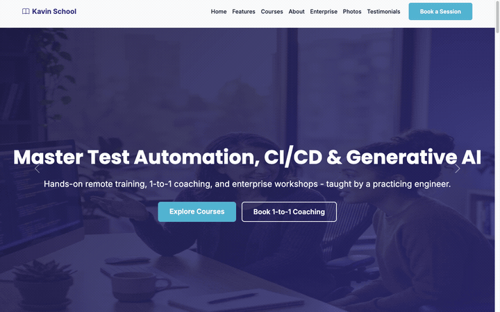
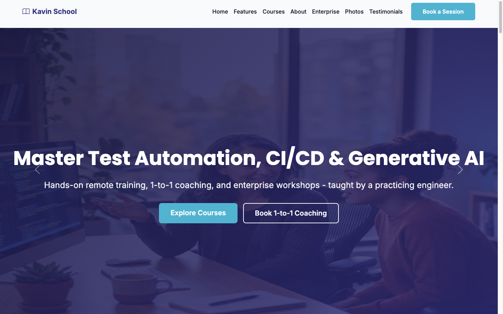
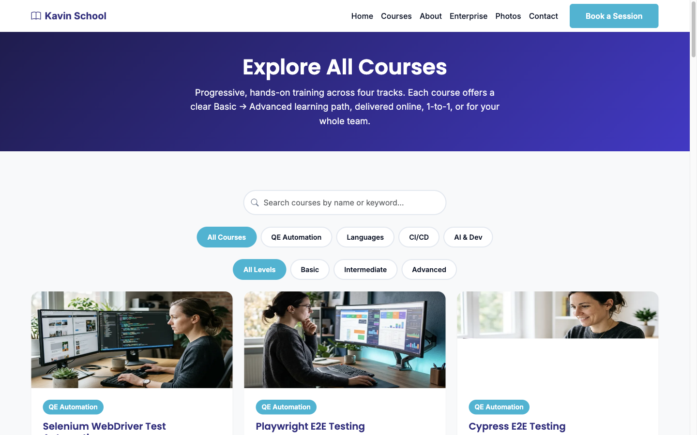
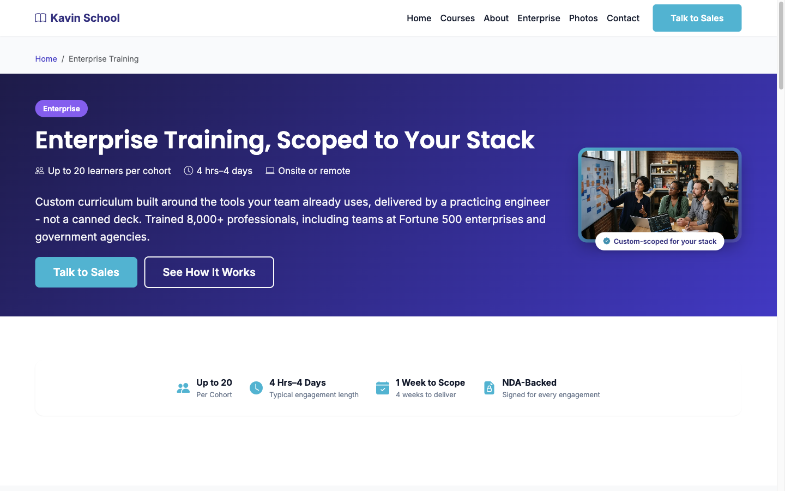
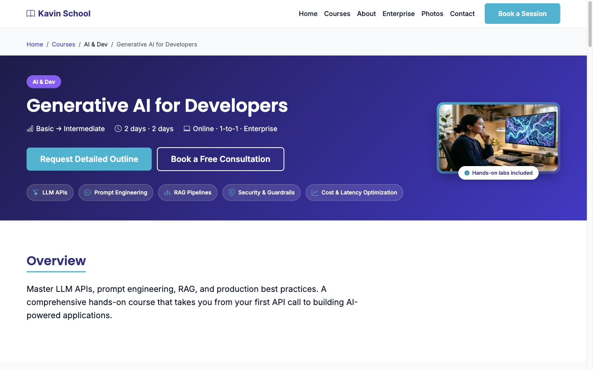
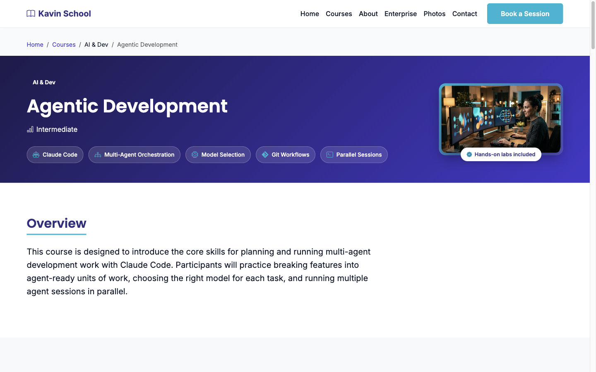

# MCP with AI Agents — Companion

Student-facing companion repository for the *MCP with AI Agents* course. Contains hands-on labs, exercises, and supporting code for use during and after the class.

## Course Provider Showcase

Explore the learning experiences and training options available from [Kavin School](https://kavinschool.com/).

*Showcase — A tour of Kavin School's course catalog, enterprise training, and featured AI courses.*

*Home — Hands-on technical training, one-to-one coaching, and enterprise workshops.*

*Courses — Search and filter the complete catalog by track and experience level.*

*Enterprise Training — Custom programs scoped to each team's technology stack and goals.*

*Generative AI for Developers — Applied training in LLM APIs, prompt engineering, RAG, security, and production optimization.*

*Agentic Development — Practical workflows for Claude Code, multi-agent orchestration, model selection, and parallel development.*

## Related Repositories

- [mcp-agents-setup](https://github.com/kpassoubady/mcp-agents-setup) — Pre-class setup and environment verification.
