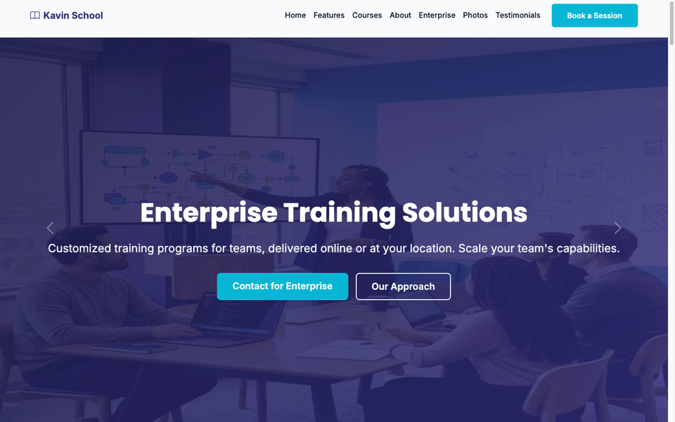
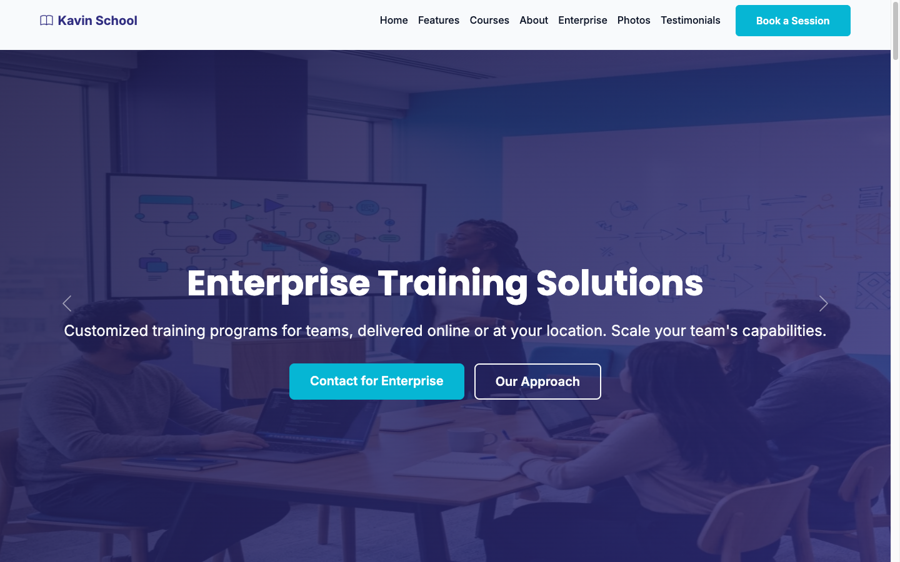
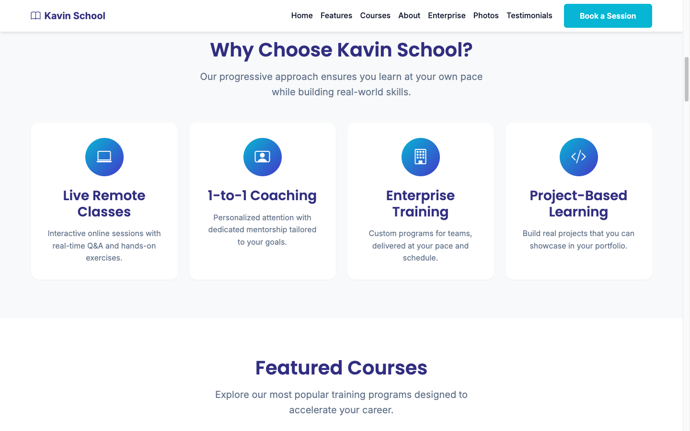
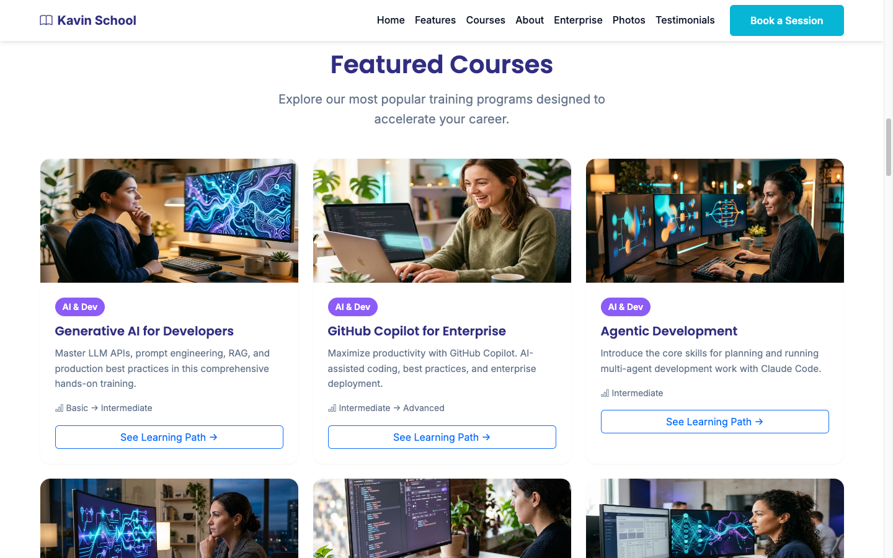
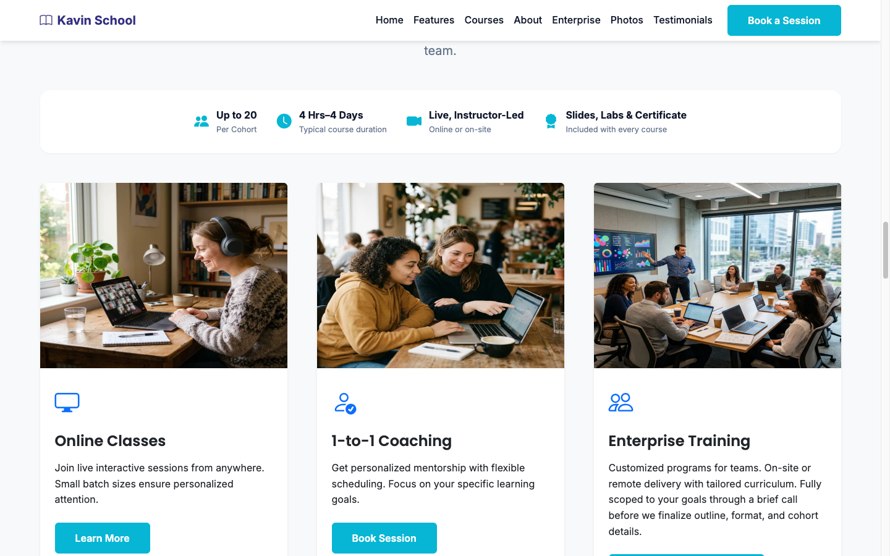
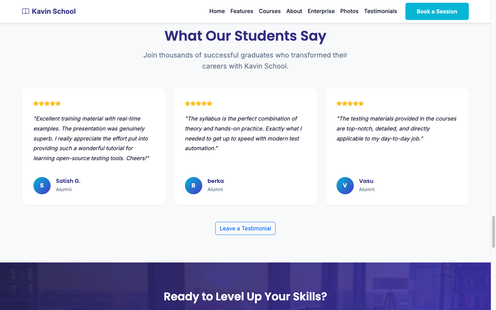

# MCP with AI Agents — Companion

Student-facing companion repository for the *MCP with AI Agents* course. Contains hands-on labs, exercises, and supporting code for use during and after the class.

## Demo: Kavin School

A walkthrough of [kavinschool.com](https://kavinschool.com/), the course provider's site.

Individual frames:

| | |
|---|---|
|  |  |
| Hero — course value proposition and trust stats | Why Choose Kavin School — feature highlights |
|  |  |
| Featured Courses — AI & Dev, Languages tracks | Flexible Learning Options — online, 1-to-1, enterprise |
|  | |
| Student Testimonials | |

## Related Repositories

- [mcp-agents-setup](https://github.com/kpassoubady/mcp-agents-setup) — Pre-class setup and environment verification.
